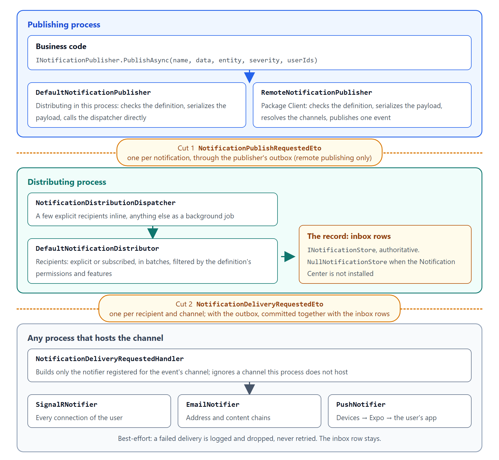
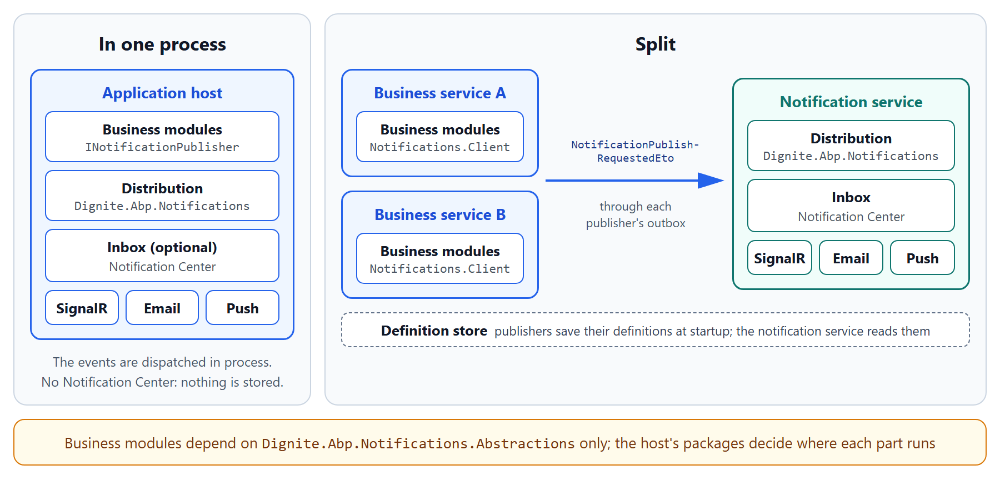

# Notifications, a Module for ABP: A Notification Pipeline Cut at the Distributed Event Bus

Dignite Notifications is an open-source module (LGPL-3.0) built on ABP Framework. Business code publishes a notification; the module decides who receives it, keeps a record of it, and gets it to people through SignalR, email or a push to their phone's app. The optional Notification Center adds a persistent inbox, subscriptions and read state, stored with EF Core or MongoDB, with an MVC and an Angular UI. The module can run inside a business system's own process, or be deployed as a notification service of its own.

The hardest part of a notification module to design is where to cut the pipeline: choosing the recipients, keeping the record and delivering through each channel - which of these belong together, and which apart. This article shows where this module cuts it, and how the cut is implemented. It assumes a few ABP basics: modules and dependency injection, the distributed event bus (with its outbox and inbox), and background jobs.

## The Problem

A notification has three things to do:

1. **Decide who receives it**: the users named explicitly, or those subscribed to it, filtered by permissions and features.
2. **Keep a record**: one inbox row per recipient, read or unread.
3. **Reach the person**: a real-time message in the browser, an email, a push to the app on their phone.

A common implementation does all three in one call. ASP.NET Boilerplate, the framework ABP grew out of, is an example: its distribution job resolves the recipients, writes a row for each of them, and then, in the same method, calls each configured notifier in turn; a publisher can also name the notifiers a notification should use, by the notifier's type name.

Binding the three together fails where they differ:

- **They live in different places.** The record belongs with the inbox's database; a channel belongs with its SDK and its credentials. One call means one process: putting push in another service, or letting a business microservice publish without hosting the inbox, is not possible.
- **They fail differently.** An inbox row is written or rolled back. An email provider timing out or a push service throttling is the channel's own problem: the record should not fail with it, and should not wait for it in the same transaction.
- **They are decided by different parties.** Who receives a notification is the business's decision; which channels carry it is the host's: a reusable module does not know which channels the host installed. Naming channels at publish time hands that decision to the party that knows least.

## The Idea: The Record Is Authoritative, Delivery Is an Event

The cut is made at ABP's distributed event bus.

The distributor does the first two things: it settles the recipients and writes their inbox rows. It does not do the third. Instead, it publishes one `NotificationDeliveryRequestedEto` for each recipient and channel. Each channel is a handler of that event, and delivers in whichever process it is installed in.

The two sides are not equal: **the inbox row is authoritative; channel delivery is best-effort.** A real-time message is only a prompt, after which the UI refreshes from the REST API; an email that could not be sent leaves the notification in the inbox.

There is a matching cut before distribution: publishing can be an event too. A process that publishes but does not distribute hands the whole notification over as one `NotificationPublishRequestedEto`, and the process that hosts the inbox distributes it.



*The path of one notification. Both cuts are distributed events: the publish request before distribution, the delivery requests after it.*

With the pipeline cut there, several things follow:

- **Channels are plug-ins.** A notifier depends only on the contracts package `Dignite.Abp.Notifications.Abstractions` and its own SDK; the pipeline knows no channel names. Adding a channel changes neither the pipeline nor the channels existing notifications take.
- **The inbox is optional.** Without the Notification Center, the store is one that does nothing, and the pipeline still publishes the delivery events: an application that only needs real-time alerts needs no notification tables.
- **The record and the delivery can commit together.** The inbox rows and the delivery events are written in the distribution's unit of work; with ABP's transactional outbox, they commit or roll back together.
- **The process boundary is a deployment choice.** A channel in another process is a matter of where its handler is installed; a publisher in another process is a matter of one more event. Business code only ever calls `INotificationPublisher`.
- **The payload crosses every boundary unchanged.** It is serialized once, at publish time, tagged with a stable type name, and travels as the same string through the database, the events, another process and the front end.

## The Implementation

### One Batch of Recipients: The Record First, Then the Events

`DefaultNotificationDistributor` processes recipients in batches (an explicit list in chunks, subscribers in keyset pages), and each batch is the cut described above:

```csharp
// A definition's permission and feature requirements apply to explicit recipients and
// subscribers alike: passing userIds does not bypass authorization
var eligible = new List<Guid>(candidates.Count);
foreach (var userId in candidates)
{
    if (await DefinitionManager.IsAvailableAsync(notification.NotificationName, userId))
    {
        eligible.Add(userId);
    }
}

// The record: the notification once, one inbox row per recipient
if (!state.NotificationInserted)
{
    await Store.InsertNotificationAsync(notification, cancellationToken);
    state.NotificationInserted = true;
}
await Store.InsertUserNotificationsAsync(inboxRows, cancellationToken);

// The delivery: one distributed event per recipient and channel
foreach (var userId in eligible)
{
    foreach (var channel in channels)
    {
        await DistributedEventBus.PublishAsync(CreateDeliveryRequest(notification, userId, channel));
    }
}
```

The distributor calls no notifier. The channels it knows are a few strings from the routing rules (below), resolved once per notification, not per recipient.

A small explicit list of recipients is distributed inline, in the publisher's request; a notification resolved from subscriptions, or with more recipients than a threshold, goes to a background job. `NotificationDistributionDispatcher` makes that choice, for local and remote publishing alike, so both paths have the same bounds.

### The Delivery Event Is a Flat Wire Contract

```csharp
[EventName("Dignite.Abp.Notifications.NotificationDeliveryRequested")]
public class NotificationDeliveryRequestedEto : IEventDataMayHaveTenantId
{
    public Guid NotificationId { get; set; }
    public string NotificationName { get; set; }
    public string? DataJson { get; set; }   // {"type":"Shop.OrderShipped", ...}
    public NotificationSeverity Severity { get; set; }
    public DateTime CreationTime { get; set; }
    public Guid UserId { get; set; }
    public string Channel { get; set; }
    public string? EntityTypeName { get; set; }
    public string? EntityId { get; set; }
    public Guid? TenantId { get; set; }
}
```

One event is one tenant, one notification, one recipient and one channel. The payload is not a polymorphic object but a JSON string serialized in advance, for two reasons:

- ABP's event bus (with its outbox and inbox) serializes events with the default System.Text.Json options, not the application's own, and a polymorphic property does not survive that.
- The process that receives the event may not have the payload's .NET type. The distributor copies the string from the publish into the event; it never serializes it again.

The type name in the string comes from an attribute on the payload class. It is a stable name, not a .NET type name:

```csharp
[NotificationDataType("Shop.OrderShipped")]
public class OrderShippedNotificationData : NotificationData
{
    public string OrderNumber { get; set; } = default!;
}
```

Renaming an assembly or moving a type leaves the stored JSON and the events in flight readable. The same string is the front end's key: the Angular UI registers a component to render each payload type by it, and a link to follow for each `EntityTypeName`, without knowing any .NET type.

### A Channel Handles Only the One It Hosts

Every process with the implementation package receives the delivery events of every channel. `NotificationDeliveryRequestedHandler` resolves only the notifier registered for the event's channel:

```csharp
public virtual async Task HandleEventAsync(NotificationDeliveryRequestedEto eventData)
{
    var notifier = ResolveNotifierOrNull(eventData.Channel);
    if (notifier == null)
    {
        // This process does not host the channel: normal in a split deployment,
        // left to the process that does
        return;
    }

    try
    {
        await notifier.DeliverAsync(eventData, cancellationToken);
    }
    catch (Exception exception)
    {
        // Best-effort: logged and dropped, never thrown back into the event bus, never retried
        Logger.LogWarning(/* the notification id, the channel and the exception type only */);
    }
}
```

These few lines set a channel's boundaries:

- An email delivery never builds the push or SignalR notifier, and one channel failing to build does not affect the others.
- A failed delivery is not thrown back into the event bus, where it would surface in the publisher's unit of work or be redelivered by an inbox again and again.
- Not hosting a channel is legitimate. When a routing rule names a channel the process does not host, startup logs a warning by default; `RequireHostedChannels` turns it into a startup failure.

A channel's whole contract is `INotificationNotifier`: a stable `Name` and a `DeliverAsync`.

### Three Channels: SignalR, Email and App Push

The module ships three channels, each one an implementation of that contract that depends only on Abstractions and its own SDK. They start from the same delivery event and have entirely different problems to solve, which is the best argument for putting channels after the event: the distributor needs to know none of those problems.

**SignalR** is the simplest. `SignalRNotifier` turns the event into a flat `SignalRNotificationMessage` and sends it to every connection of the user:

```csharp
await HubContext.Clients.User(request.UserId.ToString()).SendCoreAsync(
    nameof(INotificationsClient.ReceiveNotification),
    new object[] { SignalRNotificationMessage.FromRequest(request) },
    cancellationToken);
```

The payload in the message is the JSON object as it was published, the same shape the REST inbox returns; the message carries no list of recipients, so a user never sees another user's id. The UI treats it as a prompt and refreshes the unread count and the list from the REST API.

**Email** has two more questions to answer: what the user's address is, and what the email for this notification says. Each is an extensible chain: `IEmailNotificationAddressResolver` resolves the address and the language (from the ABP Identity account, with `Emailing.Identity` installed), and `INotificationEmailContentProvider` builds the subject and the body by payload type. The body is built in the recipient's language, and the current culture is restored right after.

**App push** is hard outside the sending: a user has several phones, the app reports their tokens, tokens rotate and die, and people sign in to a different account on the same phone. `PushNotifier` delivers in four steps:

1. Get the user's registered devices from `IPushDeviceStore`.
2. Group them by language, and build the text once **per language**, not once per device.
3. Group them by the **push provider** recorded on each device, and send through the matching `IPushProvider`.
4. Remove the tokens the provider reports as no longer registered.

There is one channel, `Push`. Expo, FCM and APNs are providers under it, chosen per device, so a routing rule only ever names `Push`. The module ships the Expo provider, one API for both iOS and Android:

```csharp
public interface IPushProvider
{
    string Name { get; }   // "Expo", matched against the provider on each device registration
    Task<IReadOnlyList<PushSendResult>> SendAsync(
        IReadOnlyList<PushMessage> messages, CancellationToken cancellationToken = default);
}
```

The text of a push comes from a chain of content providers, as an email's does:

```csharp
public class OrderShippedPushContentProvider
    : NotificationPushContentProvider<OrderShippedNotificationData>, ITransientDependency
{
    private readonly IStringLocalizer<ShopResource> _localizer;

    public OrderShippedPushContentProvider(IStringLocalizer<ShopResource> localizer)
    {
        _localizer = localizer;
    }

    protected override Task<NotificationPushContent?> BuildOrNullAsync(
        NotificationPushBuildContext context,
        OrderShippedNotificationData data,
        CancellationToken cancellationToken)
    {
        return Task.FromResult<NotificationPushContent?>(new NotificationPushContent(
            title: _localizer["Push:OrderShipped:Title"],
            body: _localizer["Push:OrderShipped:Body", data.OrderNumber]));
    }
}
```

The silent data of a push holds four keys only, `notificationId`, `notificationName`, `entityTypeName` and `entityId`, never the payload. A push is capped at about 4 KB and passes through Apple's, Google's and the provider's servers; when the push is tapped, the app opens the matching inbox entry by `notificationId` and marks it read, and fetches the full notification from the Notification Center's API. Here too a push is only a prompt, and the inbox row is the record.

Devices are registered in the Notification Center: a `PushDevice` aggregate, and two endpoints:

```
POST /api/notification-center/push-devices/register     { "provider": "Expo", "token": "..." }
POST /api/notification-center/push-devices/unregister   { "provider": "Expo", "token": "..." }
```

The app registers on every launch, after sign-in and when the user changes its language, and unregisters at sign-out. The device's language is the culture of the registering request; the token travels only in the request body, never in a URL or a log. A token is unique across all tenants: one already registered to another user moves to the caller, so a phone gets the pushes of whoever signed in on it last. Each user has a cap on devices, and the one not reported for the longest time makes way for a new one.

`Dignite.NotificationCenter.Push` is a bridge package that implements `IPushDeviceStore` over this registry; an application without the Notification Center implements the interface itself. With `Dignite.NotificationCenter.Push.Identity` installed as well, push follows the ABP login session:

```csharp
// A device keeps the session id it was registered under; a device whose session no longer
// exists is not pushed to, and is removed from the registry
var liveSessionIds = (await SessionRepository.GetListAsync(userId: userId, cancellationToken: cancellationToken))
    .Select(session => session.SessionId)
    .ToHashSet(StringComparer.Ordinal);

return devices
    .Where(device => device.SessionId != null && !liveSessionIds.Contains(device.SessionId))
    .ToList();
```

Once the user signs out, an administrator revokes the session, the concurrent login rule ends it or it is cleaned up as inactive, the phone receives no more pushes, even when the app never got to call unregister.

For business code, sending a notification to the app is one more channel name in a routing rule.

### The Host Decides the Channels, Last

Channels are not a property of the notification's definition, and are not passed at publish time. They are configured in `NotificationRoutingOptions`:

```csharp
// A business module: defaults for its own notifications
Configure<NotificationRoutingOptions>(options =>
    options.ForNotification("Shop.OrderShipped", SignalRNotifier.ChannelName));

// The host module: configured last, overrides any of them or sets the fallback
Configure<NotificationRoutingOptions>(options =>
{
    options.ForNotification("Shop.OrderShipped", SignalRNotifier.ChannelName, PushNotifier.ChannelName);
    options.InboxOnly("Shop.WeeklyDigest");
});
```

This is plain ABP options semantics: what is configured later replaces what was configured earlier, and the host module is configured last, so the host has the final word. There are only two levels of rules, one by notification name and the fallback `Default`. A notification no rule matches goes to the inbox only, and `Default` is never "every registered channel", so installing a new channel does not quietly send existing notifications through it. A host that needs a dynamic decision, by tenant or by severity, replaces `INotificationChannelResolver`.

### The Inbox Is a Store That Can Be Empty

The distributor depends only on `INotificationStore`. The contract and its empty implementation are both in Abstractions:

```csharp
[Dependency(TryRegister = true)]
public class NullNotificationStore : INotificationStore, ISingletonDependency
```

`TryRegister` lets any store registered first win, so installing the Notification Center replaces it, and neither the pipeline nor the publishing API changes. Without an inbox one more rule has to hold: a notification with no channel could go nowhere. The distributor throws on one, and startup checks the routing for it first.

### Publishing Can Be an Event Too

A process that publishes but does not distribute installs `Dignite.Abp.Notifications.Client`, whose `RemoteNotificationPublisher` implements the same `INotificationPublisher`. What only the publisher knows is settled in the publisher:

- The notification name must be defined locally; an undefined name throws while the caller is still waiting.
- The payload is serialized here, so the receiver needs no payload type.
- The channels are resolved here, because the business module's routing defaults are configured in this process.
- Finally one `NotificationPublishRequestedEto` is published. Within a unit of work, it goes into the publisher's own outbox, in the same transaction as the business change.

One notification is one event, whatever the number of recipients. The process that hosts the inbox receives it with `NotificationPublishRequestedHandler` and hands it to the same local dispatcher, from where the path is exactly that of a local publish. The notification id the publisher generated becomes the id in the inbox, so it is also the idempotency key: ABP's event inbox deduplicates by message id, and the store's check on the notification id is a second guard.

The receiver also needs the publishers' notification definitions: the inbox groups and names notifications by them, and the permission and feature requirements are part of them. This follows ABP's permission management: every publisher saves its static definitions to a shared definition store at startup, and the receiver reads them dynamically. A notification name the receiver cannot find is refused with an exception instead of being distributed, so the event inbox retries it later, because a missing definition would mean missing requirements.

The same business code is deployed three ways, differing only in the packages installed:

```csharp
// A monolith: publishing, distribution, the inbox and the channels in one process
[DependsOn(
    typeof(AbpNotificationCenterApplicationModule),   // brings AbpNotificationsModule
    typeof(AbpNotificationCenterEntityFrameworkCoreModule),
    typeof(AbpNotificationsSignalRModule))]

// A business service: publishes only
[DependsOn(
    typeof(AbpNotificationsClientModule),
    typeof(AbpNotificationsEntityFrameworkCoreModule))]  // saves its definitions to the shared store

// The notification service: distribution, the inbox and the channels
[DependsOn(
    typeof(AbpNotificationCenterApplicationModule),
    typeof(AbpNotificationCenterEntityFrameworkCoreModule),
    typeof(AbpNotificationsEntityFrameworkCoreModule),
    typeof(AbpNotificationsSignalRModule),
    typeof(AbpNotificationsEmailingModule),
    typeof(AbpNotificationsPushExpoModule),
    typeof(AbpNotificationCenterPushModule))]
// with NotificationDefinitionStoreOptions.IsDynamicNotificationStoreEnabled on, to read the publishers' definitions
```

A business module's own module class depends only on `AbpNotificationsAbstractionsModule`, and the host chooses which of these it is.



*The same business code, in one process or split across services.*

## The Costs

- **Channel delivery has no guarantee.** There is no per-recipient delivery record, no lease and no retry; no setup guarantees that an external channel delivers exactly once. A channel that needs reliable delivery, such as SMS, has to retry in its own notifier.
- **Atomicity has preconditions.** The inbox rows and the delivery events commit together only with the outbox and a transactional unit of work; MongoDB also needs a replica set. Without the outbox, a crash can leave a notification in the inbox that no channel delivered.
- **Events multiply by recipients and channels.** A thousand recipients on two channels are two thousand events. Batches and background jobs bound each step, but the load on the event bus is real.
- **A split deployment needs a shared definition store.** A publisher's definitions are saved when it starts, and the receiver reads them within about thirty seconds; a notification that arrives in between is retried by the inbox.
- **App push ships one provider, Expo.** Sending through FCM or APNs directly takes an `IPushProvider` of your own. Expo's receipts are not polled, so a device whose app was uninstalled often stays registered until the device cap or the end of its session removes it; and following the session needs an application that keeps ABP login sessions (the session management of ABP's Identity Pro), or devices carry no session and that layer does nothing.
- **The publisher decides the channels.** A remotely published notification arrives with its channels resolved, and the notification service does not route it again by its own rules. The routing defaults are written in the business modules, which only the publisher's process has.

## Conclusion

The design comes down to one step: cut the notification pipeline at the distributed event bus, with the inbox row as the record and channel delivery as an event. The distributor only settles the recipients and writes the record; a channel is an event handler, and delivers wherever it is installed. Pluggable channels (a push to a phone's app, with its whole device lifecycle, among them), an optional inbox, the record and the delivery committing together, and remote processes that only publish all follow from that step.

Its precondition is a distributed event bus with an outbox and an inbox, with one programming model in process and across processes. ABP's is one: in a monolith it dispatches in process, and after a split it is replaced by RabbitMQ or another implementation, with no change to business code or notifiers.

## Source Code and Documentation

- [Source code](https://github.com/dignite-projects/abp-modules/tree/main/notifications)
- [Documentation](../../notifications/index.md)
- [ABP Distributed Event Bus](https://abp.io/docs/latest/framework/infrastructure/event-bus/distributed)
