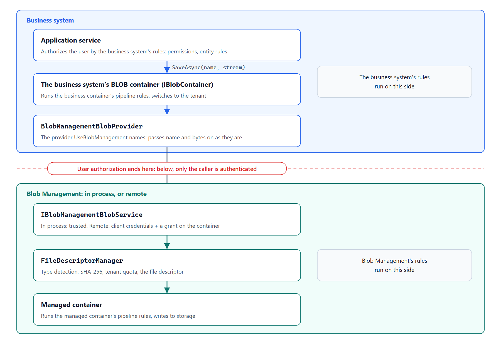
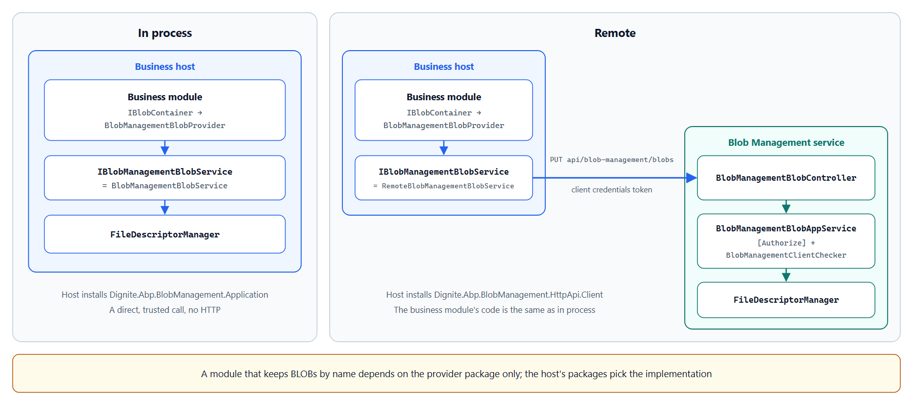
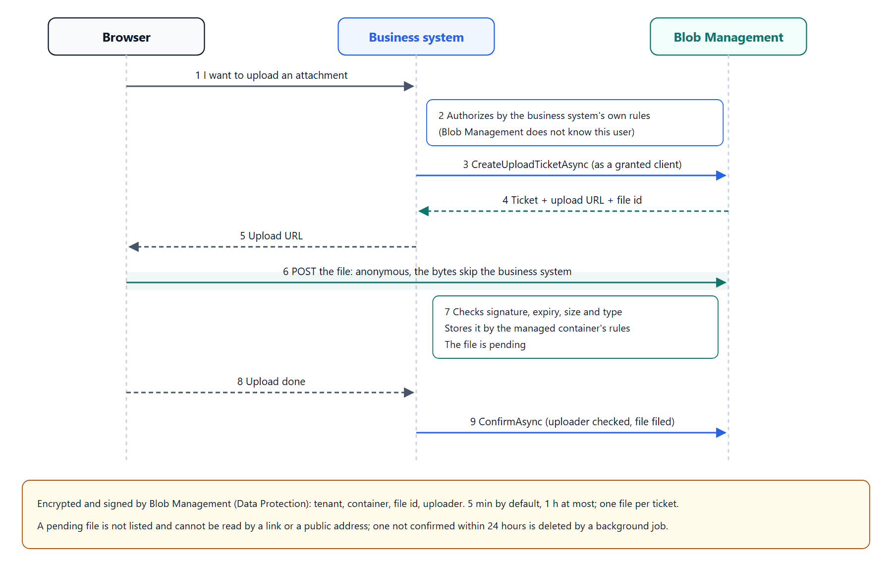

# Blob Management, a Module for ABP: A Shared File Service Built as a BLOB Storing Provider

Dignite Blob Management is an open-source module (LGPL-3.0) built on ABP Framework. It manages the BLOB containers of each tenant in an ABP application: several business systems keep their files in one place, and the module takes care of the tenant quota, the usage figures and public access for all of them. It can run inside a business system's own process, or be deployed once as a service of its own.

For a shared file service like this, the hardest part to design is permission: who decides whether an upload may go through. This article shows how Blob Management answers that question with the design of its integration entry, and how the design is implemented. It assumes a few ABP basics: modules and dependency injection, BLOB storing (`IBlobContainer` and providers), and the permission system.

## The Problem

Picture several business systems sharing one file service, one of them a content management system. An editor inserts a picture into an article, and the browser uploads it to the file service. The file service receives the request and has to decide whether to let it through.

The condition is the content system's: the user needs the "create content" permission, or, more finely, only the article's author may add pictures to it. Deciding that takes the permission definitions and the article's author, and both live in the content system. The file service has neither.

There are two common approaches, and each has a hard flaw:

- **The file service defines permissions of its own**, such as "upload files". It cannot express a business rule like "the author of this article", so administrators end up granting uploads far too widely, or the content system builds a file feature of its own after all.
- **The file service checks the business system's permissions**, say with a setting that reads "users with `Content.Create` may upload". The content system's permission name becomes a contract between two services: rename it, and the file service's setting silently stops working. The file service also has to read the content system's permission data. And a rule that needs business data, such as "only the author may add pictures", still cannot be expressed.

Both fail at the same point: the file service makes the decision, but the rules and the data the decision needs are not in its hands.

## The Idea: Move the Integration Point Down to the Storage Abstraction

A business system already has a stable interface for storing files: ABP's `IBlobContainer`. An application service authorizes the user first and then calls `SaveAsync`; the container runs the pipeline rules the business system configured (size, type, image processing) and finally hands the bytes to an `IBlobProvider`. A provider answers one question only: where the bytes go.

So Blob Management offers no upload API that authorizes users. It is a provider itself.

```csharp
Configure<AbpBlobStoringOptions>(options =>
{
    options.Containers.Configure<ProfilePictureContainer>(container =>
    {
        // The business system's own rules, run in the business system
        container.AddMaxSizeContributor(c => c.MaxSizeInBytes = 5 * 1024 * 1024);
        container.AddAllowedContentTypesContributor(c => c.AllowedContentTypes = new[] { "image/jpeg", "image/png" });

        // The bytes go to Blob Management's managed container "media"
        container.UseBlobManagement(blob => blob.BlobManagementContainer = "media");
    });
});
```

By the time a call reaches the provider, the business system has already answered "may this user upload?". On this path Blob Management neither authenticates users nor decides what they may do. The problem of integrating authorization is not solved; it no longer arises.



*The call chain of one `SaveAsync`. The provider is the boundary: the user is authorized above it, and below it only the caller is authenticated.*

With the integration point moved, several things follow:

- **Business code does not change.** The business system still programs against `IBlobContainer`; connecting it to Blob Management is one line of container configuration.
- **Each set of rules runs where it belongs.** The business container's rules run before the provider is called; the managed container's rules (size limit, types) and the tenant quota run inside Blob Management. Each rule is judged with its owner's data.
- **Blob Management only has to authenticate the caller.** What it confirms is "which business system is calling", not "which user is acting".
- **The business system does not program against Blob Management's API.** Storing and reading BLOBs by name takes one provider package; keeping files by id, asking for upload tickets and read links adds the contracts package `Dignite.Abp.BlobManagement.Application.Contracts`. Whether Blob Management runs in the business system's process or remotely is the host's choice.

## The Implementation

### The Provider Is a Thin Adapter

`BlobManagementBlobProvider` passes each ABP call on to `IBlobManagementBlobService` as it is: the name, the stream and `OverrideExisting` are left untouched.

```csharp
public override async Task SaveAsync(BlobProviderSaveArgs args)
{
    var managedContainer = GetBlobManagementContainer(args);
    var isPublic = args.Configuration.GetBlobManagementConfiguration().IsPublic;

    // The stream stays the caller's (ABP disposes what its pipeline created).
    var content = new RemoteStreamContent(args.BlobStream, fileName: args.BlobName, disposeStream: false);
    try
    {
        await BlobManagementBlobService.SaveAsync(managedContainer, args.BlobName, content, args.OverrideExisting, isPublic: isPublic);
    }
    catch (Exception exception) when (exception is IHasErrorCode { Code: BlobManagementErrorCodes.BlobAlreadyExists })
    {
        throw new BlobAlreadyExistsException(/* ... */, exception);
    }
}
```

It turns Blob Management's "name already exists" error back into ABP's own `BlobAlreadyExistsException`, so the business system sees the same behaviour as with the file system, object storage or any other provider. It does not handle tenants either: ABP's container has switched to the right tenant before it calls the provider. Even whether a file may be public comes from the business system's container configuration (`isPublic`); Blob Management only records the mark.

### One Interface, Two Implementations

The provider depends on one interface, `IBlobManagementBlobService`, which has two implementations:

- `BlobManagementBlobService`: Blob Management is in this process; it calls the domain layer directly.
- `RemoteBlobManagementBlobService`: Blob Management is a remote service; it calls its HTTP API through ABP's generated C# client proxies, with client credentials.

Which one is used depends on the package the host installs (`Dignite.Abp.BlobManagement.Application` or `Dignite.Abp.BlobManagement.HttpApi.Client`). The business module takes no part in the choice.



*The same business code, hosted two ways.*

### In-Process Trust Comes From the Shape of Dependency Injection

A call within the process is trusted: the caller is the business system's own code, and its authorization has already run. A remote call has to be checked. The implementation has no runtime test of "does this call come from the same process"; the difference comes from how two classes are registered:

```csharp
// What the provider resolves: no [Authorize], calls the domain layer directly
[RemoteService(IsEnabled = false)]
public class BlobManagementBlobService : BlobManagementAppService, IBlobManagementBlobService

// What the HTTP controller uses: derives from it, adds authentication and the client check
[Authorize]
[RemoteService(IsEnabled = false)]
[ExposeServices(typeof(IBlobManagementBlobAppService), typeof(BlobManagementBlobAppService))]
public class BlobManagementBlobAppService : BlobManagementBlobService, IBlobManagementBlobAppService
```

The HTTP controller injects only `IBlobManagementBlobAppService`; the provider resolves only `IBlobManagementBlobService`. Both turn off ABP's automatic API controllers, so the only HTTP entry is the hand-written controller. The trusted implementation has no network entry at all, so there is no "I am an in-process call" flag anyone could forge.

### Remote Calls Admit Clients Only

On the BLOB API that remote calls use, every operation goes through `BlobManagementClientChecker` first:

```csharp
public virtual string CheckIsClient()
{
    var clientId = CurrentClient.Id;
    if (string.IsNullOrWhiteSpace(clientId))
    {
        throw new AbpAuthorizationException("Blob Management's integration API is for OAuth clients: the token names no client.");
    }

    if (CurrentUser.Id != null)
    {
        throw new AbpAuthorizationException(
            "Blob Management's integration API refuses tokens that carry a user: an application calls it with its own client credentials, for its user.");
    }

    return clientId!;
}

public virtual async Task<bool> IsAllowedAsync(string containerName)
{
    return ContainerConfigurationProvider.IsManagedContainer(containerName) &&
           await ResourcePermissionChecker.IsGrantedAsync(
               BlobManagementPermissions.Container.Files,
               BlobManagementResourceNames.Container,
               containerName);
}
```

The three checks, in order: the token must belong to an OAuth client; the token must not carry a user; the client must hold `BlobManagement.Container.Files` on the target container.

Admission uses ABP's own mechanism, not a list of the module's own: an ABP resource permission can be granted to an OAuth client (provider `C`), on one managed container. An administrator ticks it in ABP's resource permission dialog, or a data seed writes one line:

```csharp
await _resourcePermissionManager.SetForClientAsync(
    BlobManagementResourceNames.Container, "media", "site-app",
    BlobManagementPermissions.Container.Files, isGranted: true);
```

The second check exists because of this mechanism. When ABP reads a client's grants it looks only at the token's `client_id`, and a user's token carries a `client_id` too. Without refusing tokens that carry a user, every user of a granted first-party front end could bypass the business system and write to the container directly. So a token that carries a user is refused, whichever client issued it; a user's request reaches Blob Management only through the business system, after its own rules.

### Direct Uploads From the Browser: Upload Tickets

With a remote deployment, an upload through the business system makes one extra hop. Letting the browser hand the file to Blob Management directly seems to require authenticating the user. It does not: who may upload is still the business system's decision, and Blob Management only issues and verifies a ticket.

Tickets belong to another interface, `IBlobManagementFileService`, which keeps files by id for a business system's own file library (names may repeat; files can be renamed, moved and filed in directories). Asking for a ticket is admitted the same way as above. Once the business system has decided about its user on the back end, it asks for a ticket:

```csharp
var ticket = await _files.CreateUploadTicketAsync(new CreateBlobManagementUploadTicketInput
{
    ContainerName = "attachments",
    MaxSize = 10 * 1024 * 1024,                     // optional: no more than the container's own limit
    AllowedContentTypes = { "application/pdf", "image/*" }, // optional: detected from the bytes
    LifetimeInSeconds = 300                         // optional
});
// ticket.UploadUrl: /api/blob-management/uploads/{ticket}
// ticket.FileId:    the id the file will have
```



*The business system authorizes; Blob Management issues and verifies the ticket, and the file stays pending until the business system confirms it.*

Blob Management encrypts and signs the ticket itself with ASP.NET Core Data Protection. It holds the tenant, the container, the file id, the uploader, the size and the types, and the browser can neither read nor change any of them. The keys never leave Blob Management: only the party that verifies a ticket can issue one, and a business system neither needs to nor should sign tickets itself.

The browser posts the file anonymously, and the stored file is **pending**. After the business system has checked that the uploader is its current user and filed the file with its business record, it calls `ConfirmAsync`; a file still unconfirmed after 24 hours is deleted by a background job. From issuing to confirming, the business system is the one that decides about the user.

## The Costs

- **Blob Management knows no business semantics.** It does not know which business record a file belongs to; the business system keeps that reference in its own data.
- **Client credentials are powerful.** One grant holds for every tenant, so a granted client can reach that container in any tenant. Its token must stay in the business system's back end.
- **A remote deployment needs shared permission data.** The client grants are stored by ABP's Permission Management, and Blob Management's host has to read them. Used only within the business system's process, it needs none of this.
- **The ticket path skips the business system's pipeline rules.** The bytes do not pass through the business system, so the rules on its container do not run. A ticket can limit size and types itself; processing such as resizing pictures or converting formats has to be declared on the managed container.
- **A remote deployment adds a network hop.** Every read and write through the provider is relayed from the business system to Blob Management. Public addresses, upload tickets and read links let the browser reach Blob Management directly and avoid it.

## Conclusion

The design comes down to one step: move the integration point from a user-facing upload API to the storage abstraction the business system already uses. Authorization is done before a call reaches Blob Management, which only has to authenticate the caller; for a business system, connecting is one line of container configuration. The two hosting modes, the structural in-process trust, admitting clients with ABP resource permissions and the upload tickets all follow from that step.

Its precondition is a framework with a storage abstraction, under which the business system's rules run before the bytes are handed on. ABP's BLOB storing is one.

## Source Code and Documentation

- [Source code](https://github.com/dignite-projects/abp-modules/tree/main/blob-management)
- [Documentation](../../blob-management/index.md)
- [ABP BLOB Storing](https://abp.io/docs/latest/framework/infrastructure/blob-storing)
